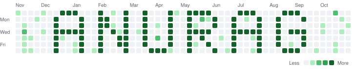

# 👋 Hi, I'm Anurag Kumar

### Full-Stack Developer | MERN | React | Node.js | Backend Engineering

<p align="center">
  <picture>
    <source media="(prefers-color-scheme: dark)" srcset="./anurag-graph-dark.svg" />
    <source media="(prefers-color-scheme: light)" srcset="./anurag-graph-light.svg" />
    
  </picture>
</p>

I'm a **Full-Stack Developer from India** focused on building practical, scalable and user-friendly web applications.

I enjoy working across the stack — from designing responsive interfaces and reusable React components to building REST APIs, authentication systems, databases and backend services.

Currently, I'm focusing on becoming a stronger **software engineer**, with particular attention to **backend engineering, system design, DSA, scalable architectures and AI-powered products**.

---

## 🚀 About Me

* 💻 Full-Stack Developer with professional experience building web applications
* ⚛️ Strong focus on **React.js, Next.js, Node.js and Express.js**
* 🗄️ Experience working with **MongoDB, MySQL and SQL Server**
* 🔐 Interested in authentication, APIs, backend architecture and application security
* 🧠 Currently strengthening **DSA and System Design**
* 🤖 Exploring **AI-powered applications and products**
* 🛠️ Comfortable working across both frontend and backend
* 🌱 Interested in building products rather than just writing code
* 🤝 Open to collaborating on meaningful full-stack and open-source projects

---

## 🧑‍💻 Professional Journey

### Software Engineer / Full-Stack Developer

I've worked across multiple environments and projects, gaining experience with:

* **MERN Stack**
* React.js & Next.js
* Node.js & Express.js
* Angular
* .NET / C#
* MongoDB
* MySQL / SQL Server
* REST APIs
* Authentication & authorization
* Git & GitHub
* Responsive UI development
* PWA development
* Real-time applications
* Deployment and production environments

My goal is to continuously move from **"someone who can build applications"** toward **"an engineer who understands why applications are designed the way they are."**

---

## 🛠️ Tech Stack

### Frontend

<p>

</p>

**React.js • Next.js • Angular • JavaScript • TypeScript • HTML5 • CSS3 • Tailwind CSS • Bootstrap • Redux**

### Backend

<p>

</p>

**Node.js • Express.js • REST APIs • .NET • C#**

### Databases

<p>

</p>

**MongoDB • MySQL • PostgreSQL • SQL Server • SQLite**

### Tools & Platforms

<p>

</p>

**Git • GitHub • Postman • Firebase • Vercel • Netlify • Linux • Figma**

### Also Worked With

**Angular • React Native • Socket.io • Redux-Saga • Zustand • PWA • Three.js • WordPress • Elementor • WordPress CLI • PHP**

---

## 📚 Currently Learning

I'm intentionally focusing on fundamentals instead of endlessly adding technologies to my stack.

### Current Focus

```text
DSA
 ↓
Problem Solving
 ↓
Backend Engineering
 ↓
System Design
 ↓
Scalable Applications
 ↓
AI-powered Products
```

### Learning Areas

* 🧩 Data Structures & Algorithms
* 🏗️ System Design
* ⚙️ Advanced Node.js & Backend Development
* 🗄️ Database Design & Optimization
* 🔐 Authentication & Security
* 🚀 Application Scalability
* 🤖 AI Integration
* ☁️ Deployment & Production Engineering

---

## 🔨 Projects

I enjoy building projects that solve real problems and help me understand engineering concepts through implementation.

### 🤖 Power of AI

An AI-focused project exploring how AI can be integrated into useful products and workflows.

**Focus:** AI • Full-Stack Development • Product Engineering

---

### 📚 WordBook

A reading/learning-oriented application designed around improving the way users work with words and knowledge.

**Focus:** React • Full-Stack Development • User Experience

---

### 🛒 BookBazaar

A marketplace concept for buying and selling books.

**Focus:** MERN • Marketplace Architecture • APIs • Database Design

---

### 🎯 HabitHarbor

A productivity and habit-tracking concept focused on helping users consistently work toward their goals.

**Focus:** Next.js • UI/UX • State Management • Persistent Data

---

### 🏢 TopDevFirms

A platform concept for discovering and exploring software development companies.

**Focus:** Web Development • Data • Search • Product Design

---

### ✍️ CaptionPro

A tool-oriented project focused on generating and managing social-media captions.

**Focus:** React • AI/Product Integration • UX

---

## 🧠 Engineering Interests

I'm particularly interested in understanding:

* How large applications are structured
* How APIs are designed
* How databases scale
* Caching strategies
* Authentication & authorization
* Background jobs
* Message queues
* Real-time systems
* Load balancing
* Microservices vs monoliths
* API performance
* Database indexing
* Distributed systems
* Cloud architecture

---

## 📈 My Current Developer Goal

I don't want to simply keep collecting technologies.

My current goal is to become a developer who can:

> **Understand a problem → design the system → build the backend → build the frontend → deploy it → monitor it → improve it.**

I'm working toward becoming a stronger **Full-Stack / Backend Engineer** with solid DSA and System Design fundamentals.

---

## 📊 GitHub Stats

<p align="center">
  
  
</p>

<p align="center">
  
</p>

---

## ✍️ Writing & Learning

I also write about technology, development and things I'm learning along my software engineering journey.

🌐 **Portfolio / Blog:**
(https://anuragkumar.dpdns.org/)

---

## 🤝 Let's Connect

<p align="left">
<a href="https://github.com/keshri29">

</a>
<a href="https://www.linkedin.com/in/anurag-kumar-aab8a61a7/">

</a>
<a href="https://x.com/keshri029">

</a>
<a href="https://www.instagram.com/anurag.env/">

</a>
<a href="mailto:keshrianurag690@gmail.com">

</a>
</p>

---

## ⚡ A Little About Me

```javascript
const anurag = {
    role: "Full-Stack Developer",

    primaryStack: [
        "React",
        "Next.js",
        "Node.js",
        "Express",
        "MongoDB"
    ],

    currentlyLearning: [
        "DSA",
        "System Design",
        "Backend Engineering"
    ],

    interests: [
        "Scalable Systems",
        "AI Products",
        "Open Source",
        "Product Engineering"
    ],

    philosophy:
        "Build. Learn. Break things. Understand why. Build better."
};
```

---

### ⭐ If you find something useful here

Feel free to explore my repositories, open an issue, or connect with me.

**Thanks for visiting! 🚀**
